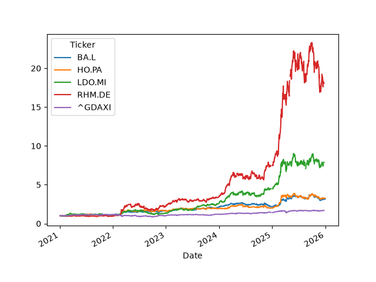

# Defence Stocks Event Study

How did key events of the war in Ukraine affect European defence stocks?

## Research question
This project looks at how the share prices of four major European defence companies reacted to key political and military events connected to the war in Ukraine (2021–2025), and whether those reactions were different from the overall market.

## Data
- **Companies:** Rheinmetall (Germany), BAE Systems (UK), Thales (France), Leonardo (Italy)
- **Benchmark:** DAX (German stock market index)
- **Period:** January 2021 – December 2025, daily closing prices
- **Source:** Yahoo Finance, downloaded with the yfinance Python library

## Method
I used a simple **event study**:
1. Calculated daily returns for each stock and the DAX.
2. Calculated **abnormal returns**: the stock's return minus the DAX return on the same day.
3. For each event, added up the abnormal returns over the **3 trading days after the event**.

## Events studied
| # | Date (first trading day) | Event |
|---|---|---|
| 1 | 24 Feb 2022 | Russian full-scale invasion of Ukraine |
| 2 | 28 Feb 2022 | Germany announces Zeitenwende and a €100bn defence fund |
| 3 | 12 Sep 2022 | Ukrainian counteroffensive in Kharkiv region, liberation of Kupiansk |
| 4 | 4 Mar 2025 | EU announces ReArm Europe plan |
| 5 | 2 Jun 2025 | Operation Spiderweb: Ukrainian drone strike on Russian strategic bombers |
| 6 | 25 Jun 2025 | NATO agrees 5% of GDP defence spending target |
| 7 | 18 Aug 2025 | Trump–Putin summit in Alaska (15 Aug) |

## Results

**3-day abnormal returns (vs DAX):**

| Event | Rheinmetall | BAE Systems | Thales | Leonardo |
|---|---|---|---|---|
| Invasion | +36.2% | +19.7% | +21.9% | +24.5% |
| Zeitenwende | +42.8% | +14.8% | +16.0% | +18.9% |
| Kupiansk | −3.9% | −1.2% | +0.9% | +1.0% |
| ReArm Europe | +3.6% | +0.1% | +9.6% | +1.9% |
| Spiderweb | −3.9% | +2.0% | −1.0% | −3.1% |
| NATO 5% | +2.6% | +1.8% | +1.7% | +2.1% |
| Alaska summit | −3.5% | −1.5% | −2.2% | −8.7% |

**Volatility (std of daily returns):** Rheinmetall 2.5%, Leonardo 2.2%, Thales 1.7%, BAE Systems 1.6%, DAX 1.0%.

## Findings
1. **The largest reactions were at the start of the war.** All four stocks beat the DAX by 15–43% after the invasion and Zeitenwende. Rheinmetall reacted most (+42.8% after Zeitenwende).
2. **Ukrainian military successes were followed by falls in Rheinmetall** (−3.9% after both Kupiansk and Spiderweb). The market may have seen them as a sign the war could end sooner.
3. **Peace talks pushed all four stocks down.** After the Alaska summit every company fell against the DAX, Leonardo the most (−8.7%).
4. **Later policy decisions had small effects.** ReArm Europe and the NATO 5% target moved most stocks by only 0–4%. They were probably already priced in.
5. **Defence stocks are more volatile than the market.** Rheinmetall's daily returns vary 2.5 times as much as the DAX's.

These results are based on a few events of each type, so they suggest patterns rather than prove them.

## Limitations
- Only 7 events, so results could be driven by chance.
- The invasion and Zeitenwende windows overlap (24, 25 and 28 Feb), so the two effects cannot be fully separated.
- The DAX is a German index, while BAE, Thales and Leonardo are not German companies.
- Abnormal returns are market-adjusted only; a market model would be more precise.
- No statistical significance tests yet.
- Other news on the same days could also have moved prices.

## How to run
    pip install pandas yfinance matplotlib
    python main.py

## Author
Oleksandr Shchennikov, first-year BA Financial Economics student, University of Essex
